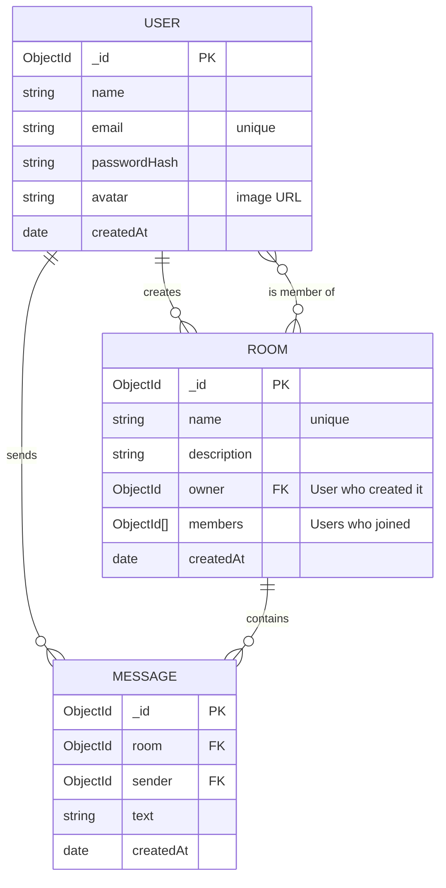

# FlashTalk: Database Schema

## Diagram

## Relationships
- One user can create many rooms (User -> Room, via `owner`)
- Many users can join many rooms (`members` array in Room)
- One user can send many messages (User -> Message, via `sender`)
- One room has many messages (Room -> Message, via `room`)

## Design decisions
- Passwords are never stored. Only `passwordHash` (bcrypt) is saved.
- Messages are in their own collection (not inside Room) so history can grow without limit and be paginated.
- Index on Message `{ room, createdAt }` so loading a room's history is fast.
- Online status and typing are NOT stored in the database. They live in server memory and change every second.
